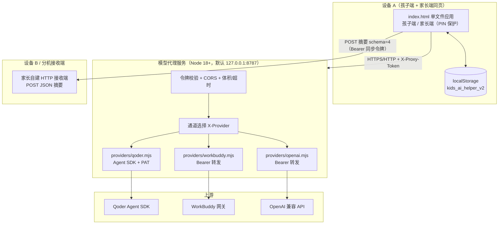
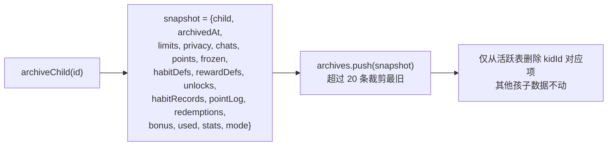
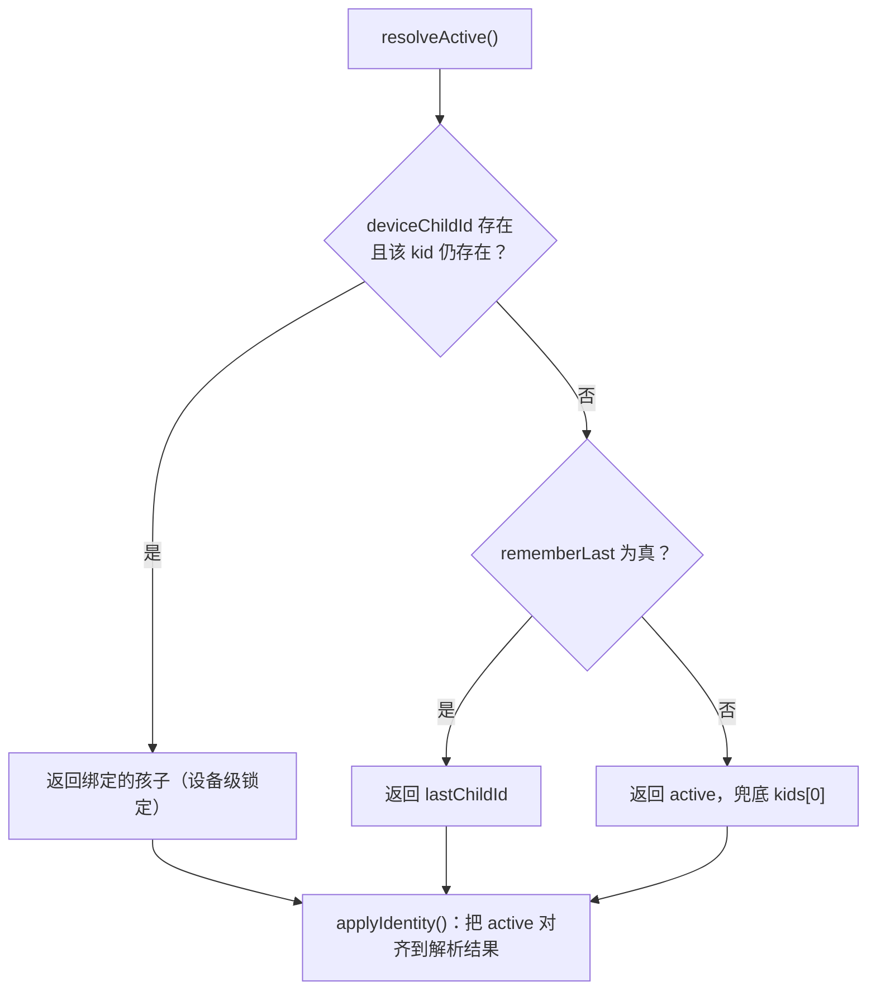
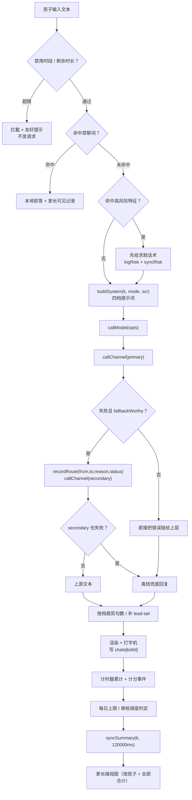
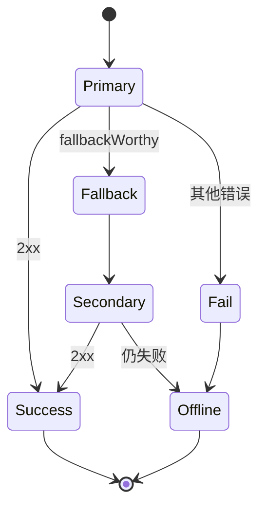
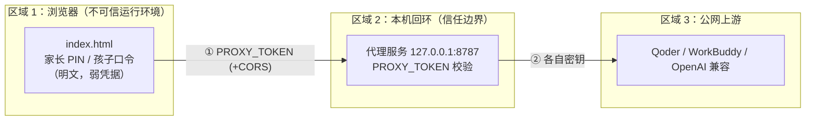
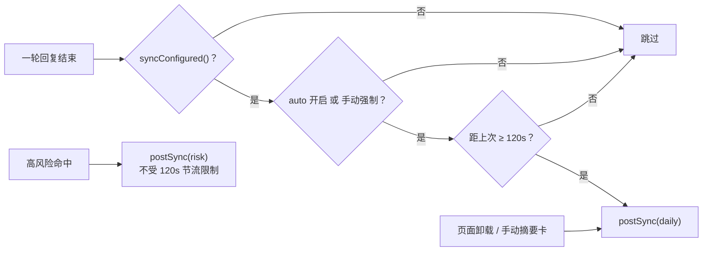
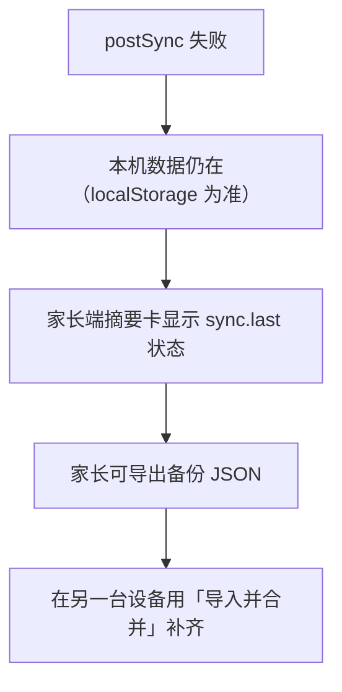
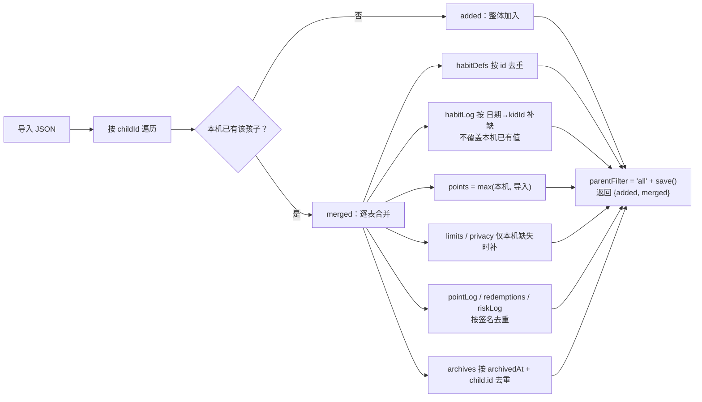

# 架构设计文档：多孩子 AI 学习助手 + 模型代理服务

| 项 | 内容 |
| --- | --- |
| 文档版本 | v1.0 |
| 对应代码 | `outputs/index.html`（单文件前端）、`server/server.mjs` + `server/providers/*`（代理服务） |
| 关联文档 | [README.md](./README.md)、[家长使用说明.md](./家长使用说明.md) |
| 适用范围 | 家庭内 1–N 个孩子共用 1–M 台设备；家长在同一页面管理；可选分机汇总 |

---

## 一、设计目标与约束

### 1.1 目标

1. **孩子可无限添加**，每个孩子有独立的年龄档、习惯、积分、限额、隐私开关、对话与记录。
2. **谁在用时自动切到谁**：设备绑定 + 记住上次 + 一键切换，切换后上下文彻底隔离。
3. **模型通道可替换**：Qoder / WorkBuddy / OpenAI 兼容 / 离线四条通道，主备自动回退，孩子端永远看不到技术错误。
4. **家长端只汇总不比较**：任何视图都不出现排名、第几名、谁更优秀。
5. **数据不丢**：备份按 `childId` 合并导入，迁移异常不写回原数据。

### 1.2 硬约束

| 约束 | 说明 |
| --- | --- |
| 无构建、单文件 | 前端全部内嵌在一个 `index.html`，双击即可用（`file://`） |
| 无第三方依赖（前端） | 只用浏览器原生 API + `localStorage` |
| 代理零框架 | Node 18+ 原生 `http`，不用 express |
| 不做生物识别 | 明确**不做声纹、不做人脸**，身份靠三件朴素机制（见 3.6） |
| 不做云账号 / 自动云同步 | 只有家长手动配置的「分机同步」单向推送摘要 |
| 孩子的对话原文不出本机 | 同步 payload 只有摘要与风险类型 |

### 1.3 关键取舍

| 决策 | 理由 | 代价 |
| --- | --- | --- |
| 单文件 HTML | 家长零安装、可 U 盘拷贝、可离线 | 文件较大，无模块化 |
| `localStorage` 而非 IndexedDB | 同步 API、易备份、易调试 | 单域 5MB 上限，需控制历史条数 |
| 代理独立进程 | 令牌不落到浏览器，密钥只在服务端 env | 家长需启动一个进程 |
| 四档而非连续年龄 | 提示词与限额可控、可测试 | 同档内差异被抹平 |

---

## 二、总体架构

### 2.1 分层视图



### 2.2 组件职责

| 组件 | 位置 | 职责 | 不负责 |
| --- | --- | --- | --- |
| 前端应用 | `outputs/index.html` | 状态机、四档提示词、通道调用与回退、计分、家长视图、备份 | 保管上游密钥、跨设备同步 |
| 代理服务 | `server/server.mjs` | 鉴权、CORS、通道分派、SSE 直通、错误归一、日志脱敏 | 业务逻辑、孩子数据 |
| 通道适配器 | `server/providers/*.mjs` | 把统一 OpenAI 风格请求翻译成各家协议 | 鉴权策略（由 server 决定） |
| 分机接收端 | 家长自建 | 接收摘要、落库、出报表 | 不接触对话原文 |

### 2.3 两种部署形态

| 形态 | 链路 | 适用 |
| --- | --- | --- |
| **同机**（默认） | 浏览器 → `127.0.0.1:8787` → 上游 | 一台电脑/一台平板跑全部 |
| **分机** | 每台设备各自 `localStorage` + 各自代理（或共用局域网代理）+ 摘要推送到家长接收端 | 多设备、家长要汇总 |

> 局域网共用代理时，必须把 `HOST` 从 `127.0.0.1` 改为 `0.0.0.0`（或具体网卡 IP），并把 `CORS_ORIGINS` 设为精确白名单；否则默认只听本机。

### 2.4 分层与依赖方向

依赖只能自上而下：**UI → 状态层 → 通道层 → 传输层**。代理服务不反向依赖前端任何结构，只认 OpenAI 兼容协议，因此换掉前端也不影响代理。

---

## 三、数据模型（多孩子核心）

### 3.1 根结构

单一 key：`kids_ai_helper_v2`。迁移失败时原文备份到 `kids_ai_helper_v2_migration_backup`（只写不覆盖业务 key）。

```jsonc
{
  "kids": [ { /* childProfile */ } ],
  "active": "k7",
  "identity": { "deviceChildId": null, "rememberLast": true, "lastChildId": "k7" },
  "archives": [ { /* 归档快照 */ } ],
  "parentFilter": "all",

  "chats":      { "k7": [...], "k13": [...] },
  "points":     { "k7": 0, "k13": 0 },
  "frozen":     { "k7": 0, "k13": 0 },
  "limits":     { "k7": { "minutes": 30, "start": "20:30", "end": "07:00" } },
  "privacy":    { "k13": { "fullAccess": false, "consent": false } },
  "habitDefs":  { "k7": [...] },
  "habitLog":   { "2026-11-05": { "k7": {...}, "k13": {...} } },
  "rewardDefs": { "k7": [...] },
  "unlocks":    { "k7": [...] },
  "pointLog":   [ { "ts": 0, "kidId": "k7", "delta": 1 } ],
  "redemptions":[ { "ts": 0, "kidId": "k7", "rewardId": "r1" } ],
  "pointsCfg":  { "mode": { "k7": "manual", "k13": "mixed" }, "dailyCap": 30 },
  "riskLog":    [ { "ts": 0, "kidId": "k7", "riskType": "..." } ],
  "parent":     { "pin": "" },
  "model":      { "primary": "offline", "secondary": "offline", "channels": {...}, "routeLog": [...] },
  "sync":       { "url": "", "token": "", "auto": true, "last": null, "lastSummaryAt": 0 }
}
```

**分表原则**：凡"属于某个孩子"的数据，键必须是 `kidId`（或日期 → `kidId` 二级键）。这样新增孩子 = 新增一个键，不需要改任何读取逻辑。

### 3.2 孩子档案 `childProfile`

由 `childProfile(raw, ageFallback)` 统一补齐，所有来源（默认值、用户新建、旧数据迁移、备份导入）都走这一个函数。

| 字段 | 类型 | 规则 |
| --- | --- | --- |
| `id` | string | 旧数据**保留原 id**（迁移不重算，避免历史记录错位） |
| `name` | string | 非空 |
| `age` | number | 决定档位 |
| `emoji` | string | 头像 |
| `passcode` | string | `^\d{4}$` 或空；空 = 不校验 |
| `habitSet` | `little` / `teen` | 年龄 ≤8 默认 little |
| `notice` | boolean | 隐私须知同意；13 岁及以上默认 true，否则 false |
| `banned` | string[] | 最多 10 条自定义禁聊词 |
| `archived` | boolean | 归档标记 |
| `createdAt` | number | 首次写入时间 |

### 3.3 四档年龄带 `BANDS`

| key | 标签 | 年龄 | 单次最多句数 | 内部 level |
| --- | --- | --- | --- | --- |
| `little` | 小朋友档 | ≤8 | 2 | `little` |
| `junior` | 小学生档 | 9–12 | 3 | `teen` |
| `teen` | 少年档 | 13–15 | 6 | `teen` |
| `senior` | 青少年档 | 16+ | 9 | `teen` |

`bandKeyOf(age)`：≤8 → little；≤12 → junior；≤15 → teen；其余 senior。
`bandOf(k)` 返回档对象，`levelOf(k)` 仍是 **little / teen 二分** —— 这是刻意的：四档只影响**提示词、限额、文案**，而历史逻辑（哪些功能可用、隐私默认）继续用二分，避免一次性改动过多分支。

四档的差异化不只在句数，`bandStyle` 还给出不同的**作答结构**：

| 档 | lead（开头） | tail（收尾） | tone |
| --- | --- | --- | --- |
| little | 不加 lead，直接从具体事物说起 | 一句安抚 + 求助提示 | 极短、具象 |
| junior | 先结论，再给原因 | 一句"可以再问我" | 简单因果 |
| teen | 平等说明原理与边界 | 提醒自己判断 | 讲原理 |
| senior | 分三层：结论 / 依据 / 不确定处 | 区分事实与推断 | 严谨、去说教 |

### 3.4 默认限额 `defaultLimitsFor(k)`

| 档 | 每日分钟 | 禁用时段起 | 止 |
| --- | --- | --- | --- |
| little | 30 | 20:30 | 07:00 |
| junior | 45 | 21:00 | 06:30 |
| teen | 60 | 22:00 | 06:30 |
| senior | 90 | 23:00 | 06:00 |

仅在新建孩子、且该孩子尚无 `limits` 记录时写入；已有记录一律不覆盖（这也是 `updateChild` 在 `minutes/start/end` 缺失时回退 `prev` 值的原因）。

### 3.5 归档快照 `archives`

`archiveChild(id)` 先做**整体快照**，再只从活跃分表删除该孩子：



要点：归档是**可逆的语义保留**（人走了，数据还在），不是硬删除；快照里 `pointLog/redemptions/habitRecords` 都按 `kidId` 抽取，避免把别人的记录卷进来。上限 20 条防止 localStorage 无界增长。

### 3.6 身份与绑定 `identity`

三件朴素机制，**不做生物识别**：



| 函数 | 作用 | 副作用 |
| --- | --- | --- |
| `deviceBoundKid()` | 读 `identity.deviceChildId` 并校验孩子仍存在 | 无（纯查询） |
| `resolveActive()` | 三级回退解析"现在应该是谁" | 无 |
| `applyIdentity()` | 把解析结果写回 `active` | 改 `active` |
| `switchChild(id, opts)` | 手动切换 | 口令校验 → 停计时器 → 清 `currentMode` → 关聊天页 → **清空 `#messages`** → 写 `active` 与 `lastChildId` → 存盘 → 重绘首页 |
| `bindDevice(id)` | 把本机固定给某个孩子 | 写 `deviceChildId` + `lastChildId` |
| `unbindDevice()` | 解除设备锁定 | 清 `deviceChildId`，回落到 `rememberLast` |

**上下文隔离的实现**：切换时 `stopUsageTimer()`、`currentMode = null`、`#chatScreen` 加 `hidden`、`document.body` 移除 `chat-open`、`#messages.innerHTML = ''`、`#storyBar` 隐藏。即：**UI 层清空 + 逻辑层清模式 + 数据层按 kidId 取**，三重保证不串。

**口令的定位**：`passcode` 是 4 位数字，用于**防止孩子误切到别的孩子**，不是安全认证。它是明文存储、可被家长查看、可被改库绕过 —— 文档与家长说明中均明确这一点。

### 3.7 迁移与异常保护

```js
function loadState() {
  // 1) 解析失败 或 3) 迁移抛错 → 不写回
  // 2) localStorage.setItem(KEY + '_migration_backup', raw)   // 只备份原串
  // 3) 返回经过 normalizeState 的安全状态，并带 migrateWarn 提示
}
```

`normalizeState(base, s)`：浅合并各表 → `kids = rawKids.map(x => childProfile(x, x.age))`（**保留旧 id**）→ `identity` 归一（`rememberLast` 仅在显式 `false` 时关闭）→ `active` 不存在则回 `kids[0]` → `parentFilter` 默认 `all`。

设计原则：**迁移宁可少补字段，也不能改 id、不能覆盖原数据**。任何异常都退化为只读 + 提示，而不是清库。

---

## 四、数据流

### 4.1 一次对话的完整链路



| 阶段 | 关键函数 | 失败时的表现 |
| --- | --- | --- |
| 准入 | 限额 / 禁聊 / 风险判定 | 本地拦截，不发网络请求 |
| 提示词 | `buildSystem` | 纯本地，不会失败 |
| 通道选择 | `callModel` | 主备回退；双失败转离线 |
| 传输 | `callChannel` | `TIMEOUT` / `NETWORK` / `HTTP status` 分类错误 |
| 后处理 | 档位裁剪 | 只影响长度，不影响可用性 |
| 落库 | `save()` | 写失败仅影响持久化，当前会话仍可用 |
| 汇总 | `syncSummary` | 静默失败，写 `sync.last` |

### 4.2 系统提示词构建 `buildSystem(k, mode, scr)`

```
bandLine = "年龄档：{age} 岁（{label}，{range}）。语气：{tone}；回答不超过 {maxSent} 句。"
```

| 分支 | 追加内容 |
| --- | --- |
| `little` | 9 条硬规则：一次只讲一个点；2–3 句；不反问孩子；讲到危险信号时第一句是"请现在去找爸爸妈妈"；不用比喻堆砌；等等 |
| `junior` | 先结论后原因 + 简单因果 + 一句"可以再问我" |
| `teen` | 讲原理与边界 + 平等语气 + 提醒自己判断 |
| `senior` | 三段式（结论/依据/不确定）+ 区分事实与推断 |

所有档位共享的约束：**禁止代替家长做决定**；讲题先给思路不给答案；不评价孩子本人，只评价这次做法。

### 4.3 通道调用与主备回退



`fallbackWorthy(err)` 判定为真的条件：

| 类别 | 具体 |
| --- | --- |
| 错误种类 | `TIMEOUT`（30s 超时）、`NETWORK`（跨域或不可达）、`NO_CONFIG`（通道未配置） |
| HTTP 状态 | `401`、`403`、`429`、`501`、`≥500` |

反之（如 `400` 参数错误、`404` 路径错误）**不回退**，直接报错——因为换通道也一样错，回退只会掩盖问题。

`recordRoute(from, to, err)` 写入 `model.routeLog`：

```jsonc
{ "ts": 0, "from": "qoder", "to": "workbuddy", "reason": "超时", "status": 504 }
```

上限 **50 条**，环形裁剪。孩子端只看到"这次换了个方式回答你"，技术原因只进 `routeLog`（家长端可查）。

### 4.4 通道适配细节

| 通道 | 前端 id | 代理 provider | 鉴权头 | 特点 |
| --- | --- | --- | --- | --- |
| Qoder | `qoder` | `qoder` | `Authorization: Bearer <apiKey>`（前端传代理令牌）+ `X-Provider: qoder` | 代理侧用 PAT 调 Agent SDK；模型 `auto/ultimate/performance/efficient/lite` |
| WorkBuddy | `workbuddy` | `workbuddy` | 同上，`X-Provider: workbuddy` | 纯 Bearer 转发 |
| OpenAI 兼容 | `openai` | `openai-compatible` | 同上，`X-Provider: openai-compatible` | 可直连上游，也可指向代理 |
| 离线 | `offline` | — | — | 本地模板回答，永远可用 |

**三套通道标识的映射**是刻意的：前端用短名（`openai`），代理用协议名（`openai-compatible`），通过 `X-Provider` 显式传递，避免"名字看起来一样但语义不同"。

`endpointFor(id)`：去尾斜杠；若已含 `/chat/completions` 则原样使用，否则拼接 `/chat/completions`。这让家长填 `https://api.deepseek.com/v1` 或填完整 URL 都能工作。

**自定义头的加与不加**：仅当 `id !== 'openai'` **或** 目标是本地代理（`isLocalProxy(url)`）时，才加 `X-Proxy-Token` 与 `X-Provider`。这样直连公网 OpenAI 兼容服务时不会把代理令牌发给第三方。

### 4.5 离线兜底

当所有通道不可用，用本地模板按档位给出回复：低龄给具象步骤，高龄给原理框架。离线模式同时是**默认主通道**（`primary: 'offline'`），保证新装即用、断网可用。

### 4.6 计分与家长审核

| 环节 | 触发 | 结果 |
| --- | --- | --- |
| 行为计分 | 习惯打卡 / 完成任务 | `habitLog`、`pointLog` 按 `kidId` 记录 |
| 手动记账 | 家长在积分页填分值 + 理由 | `adjustPoints` → `kind='manual'` 流水；不受上限，扣分不越过可用积分 |
| 每日上限 | `pointsCfg.dailyCap`（默认 30） | 超出不加分 |
| 审核阈值 | `reviewThreshold`（默认 20） | 进入待家长确认队列 |
| 信任降级 | 异常检测 | `pointsCfg.anomalies`、`aiStats.revoked` |

`pointsCfg.mode` 按孩子区分：little 默认全部 `manual`（家长逐条确认），其余默认 `mixed`（小额自动、大额人工）。

`adjustPoints(k, delta, reason)` 是唯一的家长手工入口：分值取整、可正可负，统一写 `kind='manual'` 流水；正数不受 `dailyCap` 约束，负数最多扣到 `availableOf(k)`（即 `points - frozen`），因此**不会动用兑换冻结中的积分**，`delta = 0` 直接拒绝。理由必填并截断到 30 字，与撤销/驳回的备注口径一致，孩子端可见。

`stars` 的处理：`ensureKid` 在补默认值**之前**读取旧 `stars` 一次性并入 `points`，迁移完成后整体 `delete state.stars`，状态、备份与同步里不再保留第二套计分。顺序很关键——若先补 `points = 0`，迁移判断就会失配，旧分数会被覆盖。

### 4.7 写路径时机

| 事件 | 是否立即 `save()` |
| --- | --- |
| 发消息 / 收回复 | 是 |
| 切换孩子 / 绑定设备 | 是 |
| 新建 / 修改 / 归档孩子 | 是 |
| 配额扣减（定时器 tick） | 是（同时更新 UI） |
| 同步状态 `sync.last` | 是 |
| 路由日志 `routeLog` | 是（受 50 条上限） |

读取一律走内存 `state`，`localStorage` 只做持久化，避免每次渲染都解析 JSON。

---

## 五、鉴权机制

### 5.1 信任边界



**两层鉴权是分离的**：浏览器只持有"能调代理"的令牌，永远拿不到上游密钥；代理持有上游密钥，永远不把它回传。

### 5.2 第一层：前端 → 代理

| 项 | 实现 |
| --- | --- |
| 环境变量 | `PROXY_TOKEN`（必填） |
| 长度校验 | `< 16` 字符 → `[fatal]` + `exit 1`，**拒绝启动** |
| 传输方式 | `X-Proxy-Token: <token>` 或 `Authorization: Bearer <token>`（二选一） |
| 比较方式 | 两边各自 `sha256` 后再 `crypto.timingSafeEqual`（定长比较，避免长度泄漏与短路） |
| 失败响应 | `401 { "error": { "code": "unauthorized" } }` |
| 免鉴权端点 | `OPTIONS *`、`GET /health`、`GET /healthz` |

```js
function tokenOk(req) {
  const t = String(req.headers['x-proxy-token'] || '').trim() || bearer(req);
  if (!t || !PROXY_TOKEN) return false;
  const a = crypto.createHash('sha256').update(t).digest();
  const b = crypto.createHash('sha256').update(PROXY_TOKEN).digest();
  return crypto.timingSafeEqual(a, b);
}
```

要点：**先哈希再比较**，而不是直接比较原始串——这样即使日后换成更长的令牌，比较耗时也不随前缀匹配长度变化。

**健康检查不泄密**：`/health` 返回 `{ ok, service, provider, configured, channels: { 'openai-compatible': bool, workbuddy: bool, qoder: bool }, timeoutMs, version }`。只有布尔值，不返回 baseUrl、不返回密钥前缀、不返回模型全名以外的信息。

### 5.3 第二层：代理 → 上游

| 通道 | 凭证变量 | 优先级 / 备注 |
| --- | --- | --- |
| OpenAI 兼容 | `OPENAI_BASE_URL` + `OPENAI_API_KEY` + `OPENAI_MODEL` | 三者缺一 → 视为未配置 |
| WorkBuddy | `WORKBUDDY_BASE_URL` + `WORKBUDDY_API_KEY`（+ `WORKBUDDY_MODEL` 可选） | 复用 OpenAI 转发；`body.model` 缺省时用 `WORKBUDDY_MODEL` 补 |
| Qoder | `QODER_PAT` **优先于** `QODERCN_PERSONAL_ACCESS_TOKEN` | 走官方 Agent SDK，PAT 在 `https://qoder.cn/account/integrations` 创建 |

**未配置时的行为**：不报 500，而是 `501`，并给出精确 code，让家长一眼知道"是缺凭证，不是坏了"。

| 情况 | 状态 | code |
| --- | --- | --- |
| Qoder 无 PAT | 501 | `qoder_not_configured` |
| Qoder SDK 未安装 | 501 | `qoder_sdk_missing` |
| openai/workbuddy 缺 baseUrl 或 apiKey | 501 | `<provider>_not_configured` |
| 请求指定了不存在的通道 | 400 | `provider_invalid` |

**Qoder 的工具面收敛**：调用 Agent SDK 时显式 `tools: []`、`allowedTools: []`，即**不给模型任何工具权限**（不能读文件、不能执行命令）。`QODER_CWD` 默认 `os.tmpdir()`，`QODER_MAX_TURNS` 默认 `1`。这是一个重要的安全设计：儿童场景下，模型不应该有副作用能力。

### 5.4 网络面控制

| 控制项 | 默认 | 效果 |
| --- | --- | --- |
| `HOST` | `127.0.0.1` | 只监听回环，局域网不可达 |
| `PORT` | `8787` | 固定端口，便于前端默认值 |
| `CORS_ORIGINS` | `*` | 逗号分隔白名单；去尾斜杠；**精确匹配**；不匹配 → `403 cors_forbidden` |
| `MAX_BODY` | 256 KB（硬编码） | 超出 `413 body_too_large`，防止大包打爆内存 |
| `PROXY_TIMEOUT_MS` | 60000 | 上游超时 → `504 timeout` |
| 客户端断开 | — | `res.on('close')` → `ac.abort()`，同步取消上游请求，不浪费额度 |

**`file://` 的细节**：本地双击打开的页面，浏览器发送 `Origin: null`。若把 `CORS_ORIGINS` 设为具体域名白名单，必须显式包含 `null` 这一项，否则会被 403。默认 `*` 时不存在此问题。

**默认 `*` 是否危险？** 在 `HOST=127.0.0.1` 的前提下，只有本机进程能连；此时真正的门禁是 `PROXY_TOKEN`。但如果改成局域网监听，**必须同时收紧 CORS**——文档明确这条组合要求。

**预检响应**：`OPTIONS` 返回 `204`，`Allow-Methods: POST, GET, OPTIONS`，`Allow-Headers: Content-Type, X-Proxy-Token, X-Provider, Authorization`，`Access-Control-Max-Age: 86400`。白名单内回显 `Origin`，不使用 `*` + 凭证的组合。

### 5.5 数据面脱敏

| 面 | 措施 |
| --- | --- |
| 日志 | 单行 JSON，**只允许固定字段**：`t, provider, model, ms, status, stream, usage, code, credits`。不写 prompt、不写回复、不写令牌 |
| 错误回传 | 孩子端只见中文友好文案；技术细节只进 `routeLog`（本地） |
| 上游错误透传 | 非 2xx 原样透传状态与响应体——但仅在**代理返回给调用方**这一层，不进日志 |
| 备份文件 | **不含** API Key、不含代理令牌、不含同步令牌；导出前明确提示 |
| SSE 中途出错 | 已发 200 时写 `data: {"error":{...}}` + `[DONE]`，前端能识别为错误而不是"回答了一半" |

`log()` 的实现刻意用白名单构造对象，而不是 `JSON.stringify(req)`：

```js
const line = { t: ..., provider: ..., model: ..., ms: ..., status: ..., stream: !!obj.stream,
               usage: obj.usage || null, code: obj.code || '', credits: ... };
console.log(JSON.stringify(line));
```

### 5.6 应用内弱凭据的定位

| 凭据 | 保护对象 | 强度 | 明确说明 |
| --- | --- | --- | --- |
| 家长 PIN | 家长端页面 | 弱 | 明文存储，防误入，不防有心人 |
| 孩子口令（4 位） | 防止误切到别的孩子 | 弱 | 明文、家长可查、可绕过 |
| 分机同步令牌 | 摘要接收端 | 中 | 由接收端自行校验 `Authorization: Bearer` |

三者与 `PROXY_TOKEN` **不在同一信任级别**。文档与家长说明中都写明：这些是"防误操作"，不是"防攻击"。真正把密钥挡在浏览器之外的是代理服务。

### 5.7 鉴权失败矩阵

| 场景 | HTTP | code | 前端表现 |
| --- | --- | --- | --- |
| 缺/错 `PROXY_TOKEN` | 401 | `unauthorized` | 该通道判 `NO_CONFIG` 类失败 → 触发回退 |
| 起始校验不过（<16 位） | — | 进程退出 | 通道视为不可用 |
| Origin 不在白名单 | 403 | `cors_forbidden` | 浏览器侧网络错误 → `NETWORK` → 回退 |
| 上游 401/403 | 401/403 | 透传 | 回退到备用通道 |
| 上游 429 | 429 | 透传 | 回退；仍失败则离线 |
| 上游 5xx | 5xx | 透传 | 回退 |
| 上游超时 | 504 | `timeout` | 回退 |
| 代理内部异常 | 500 | `internal_error` | 回退 |

---

## 六、同步策略

### 6.1 定位与非目标

**是**：把"孩子今天用了多久、做了几件事、攒了几分、有没有高风险"这类**摘要**，单向推送给家长指定的接收端。
**不是**：不是实时聊天同步、不是云备份、不是双向通信、不传对话原文。

设计动机：家长需要在另一台设备上看到汇总，但不应该让孩子的每句话都上传到第三方。

### 6.2 Payload schema v4

```jsonc
{
  "app": "kids-ai-helper",
  "schema": 4,
  "kind": "daily",                     // daily | risk
  "sentAt": "2026-11-05T12:00:00.000Z",
  "date": "2026-11-05",

  "childId": "k7",                    // 必带：多孩子区分的关键
  "kid": { "id": "k7", "name": "阳阳", "age": 7, "level": "little", "band": "小朋友档" },

  "usage":  { "messages": 12, "minutes": 18, "limitMinutes": 30, "bonusMinutes": 0 },
  "topics": ["数学", "恐龙"],
  "tasks":  { "done": 2, "total": 3 },
  "points": { "balance": 8, "frozen": 0, "today": 3, "week": 24 },
  "habits": { "done": 4, "total": 5, "pending": 1 },
  "risks":  [ { "level": "high", "type": "情绪高风险", "ts": 0 } ],

  "note": "仅摘要与风险类型，不含对话原文"
}
```

**schema 3 → 4 的唯一变更**：新增 `childId` 与 `kid.band`。接收端必须按 `childId` 建索引，否则多孩子会混成一个人。

| 字段 | 用途 | 是否需要家长授权 |
| --- | --- | --- |
| `usage` | 时长与条数 | 是（基础） |
| `topics` | 兴趣画像 | 是（`notice`/`consent`） |
| `tasks` / `habits` / `points` | 完成度与积分 | 是（基础） |
| `risks` | 仅类型与时间，最多 10 条 | 是（安全类，建议始终开） |
| 对话原文 | —— | **永不发送** |

### 6.3 触发时机与节流



| 触发源 | 函数 | 节流 |
| --- | --- | --- |
| 每轮回复后 | `syncSummary(k, minGap, force)` | 默认 `minGap = 120000ms`，`sync.lastSummaryAt` 记录 |
| 页面卸载 | `syncSummary(..., force)` | 不受节流 |
| 家长点"立即摘要" | `syncSummary(..., force = true)` | 不受节流 |
| 高风险事件 | `syncRisk(k, label)` | **不做节流**，安全优先 |

高风险自动留痕的判定条件（同时满足才发送）：

```js
level === 'high' &&
/自伤|危机|高风险|离家出走|霸凌|欺负|抑郁|情绪高风险/.test(label)
```

命中后：`logRisk` 写本地 `riskLog`（上限 **100** 条）+ `syncRisk` 推送一条 `kind: "risk"` 事件。

### 6.4 传输与失败处理

| 项 | 值 |
| --- | --- |
| 方法 | `POST <sync.url>`，`Content-Type: application/json` |
| 鉴权 | `Authorization: Bearer <sync.token>`（令牌为空则不带该头） |
| 超时 | `AbortController` **12s** |
| 保活 | `keepalive: true`（页面卸载时仍尽量发出） |
| 结果记录 | `state.sync.last = { at, ok, status, kind[, msg] }`，随后 `save()` |
| 失败表现 | **静默**：toast 不弹给孩子，只在家长端摘要卡显示上次状态 |

**为什么是 12s 而不是 60s**：同步是"锦上添花"，不能拖住孩子的对话节奏。超时后数据仍在本机 `localStorage`，下次触发会重新发。

**为什么用 `keepalive`**：很多同步发生在页面关闭/切走的瞬间，普通 fetch 会被取消。

**失败降级链**：



即：**同步不是数据源，本机才是唯一事实来源**。这条原则保证网络异常永远不会导致数据丢失。

### 6.5 分机汇总与导入合并 `mergeBackup`



去重签名：

| 表 | 签名 |
| --- | --- |
| `pointLog` | `ts \| kidId \| delta` |
| `redemptions` | `ts \| kidId \| rewardId` |
| `riskLog` | `ts \| kidId \| riskType` |
| `archives` | `archivedAt + child.id` |

**三条铁律**：
1. **只补不覆盖**：本机已有的值优先，导入只填缺口（积分例外，取 max 反映累计）。
2. **按孩子隔离**：A 设备的 `k7` 与 B 设备的 `k7` 是同一个孩子（同 id），合并；其他孩子原样不动。
3. **导入后 `parentFilter` 归位 `all`**，避免家长还停在某个筛选里看不到新数据。

### 6.6 多设备不串的保证

| 机制 | 作用 |
| --- | --- |
| `identity.deviceChildId` | 一台设备固定给一个孩子，打开就是这个人 |
| `identity.lastChildId` | 未绑定时记住"上次是谁"，减少切换 |
| `active` | 当前运行时的孩子 id，所有读写都用它 |
| `childId` in payload | 同步端能区分来源孩子，不会把两个人合成一条曲线 |
| `kidId` 二级键 | 本地分表天然隔离，物理上不会串 |
| 切换时清 `#messages` + `currentMode` + 关聊天页 | UI 层不留上一个人的上下文 |

**多设备建议分配**：低龄孩子用固定设备（`deviceChildId` 锁定）；大孩子共用设备（不锁定 + 口令 + 一键切换）。家长设备不绑定任何孩子，只看汇总。

---

## 七、安全边界与明确不做项

### 7.1 已覆盖

| 面 | 措施 |
| --- | --- |
| 密钥位置 | 只在服务端 `.env`；浏览器只有代理令牌；备份不含任何密钥 |
| 暴力猜测 | `PROXY_TOKEN` 强校验 ≥16 位；比较用 `timingSafeEqual` |
| 网络暴露 | 默认只听 `127.0.0.1`；CORS 精确白名单；可选 `403` |
| 拒绝服务 | `MAX_BODY` 256KB；`PROXY_TIMEOUT_MS` 60s；断开即 abort |
| 信息泄露 | 日志白名单字段；`/health` 只回布尔；孩子端只显示中文友好错误 |
| 模型副作用 | Qoder 关闭全部工具（`tools: []`、`allowedTools: []`）、单轮、临时目录 |
| 儿童内容 | 分档提示词 + 禁聊词 + 高风险先求助 + 家长可见记录 |

### 7.2 明确不做

| 不做项 | 原因 |
| --- | --- |
| 声纹识别 / 人脸识别 | 隐私成本高、儿童数据敏感、家庭场景收益低；改用设备绑定 + 记忆 + 口令 |
| 云账号 / 自动云同步 | 需要托管对话数据；改为家长自建接收端 + 手动备份 |
| 多租户 / 远程登录 | 定位是家庭内单机，不做账号体系 |
| 上传对话原文用于分析 | 同步只发摘要 |
| 孩子端展示技术错误 | 会让孩子困惑，也可能暴露内部信息 |
| 用模型"诊断"心理问题 | 高风险只做求助引导与家长告知，不做判断 |

### 7.3 残余风险（须告知家长）

1. 家长 PIN 与孩子口令是**明文弱凭据**，能防误操作，不能防有意的孩子。
2. 拿到本机的人可直接读 `localStorage`，包括聊天记录。
3. 若把代理改为局域网监听且保留 `CORS_ORIGINS=*`，等同放弃来源限制——必须同时收紧。
4. 分机同步的接收端安全由家长自建方负责（建议仅内网 + Bearer 令牌）。

---

## 八、测试与验收

### 8.1 测试规模（全部通过）

| 套件 | 项数 | 覆盖 |
| --- | --- | --- |
| `test-logic.mjs`（jsdom） | 59 | 状态、迁移、四档、限额、计分 |
| `test-ui.mjs`（jsdom） | 42 | 渲染、家长视图、筛选、模态 |
| `test-unbounded.mjs`（jsdom） | 40 | 无限添加、隔离、归档、身份切换 |
| `test-multichild.mjs`（jsdom） | 74 | 多孩子专项（见 8.2） |
| `test-points-manual.mjs`（jsdom） | 18 | 手动加减分单元测试（见 8.3） |
| **jsdom 小计** | **233** | |
| `test-browser.mjs`（真浏览器） | 39 | 端到端对话、计分、家长端 |
| `test-browser-multi.mjs`（真浏览器） | 24 | 多孩子真机流程 |
| `test-browser-manual.mjs`（真浏览器） | 20 | 手动加减分表单、冻结保护、dailyCap 豁免、多孩子隔离（见 8.5 真机清单） |
| **浏览器小计** | **83** | |
| 服务端 `npm test`（mock-provider） | 36 | 路由、鉴权、CORS、错误码、SSE |
| 服务端 `npm run test:qoder` | 12 | Qoder 适配、错误码映射、SDK 缺失 |
| **服务端小计** | **48** | |
| **合计** | **364** | |

> 真浏览器测试使用 `playwright-core` + 本机 Edge，以 `file://` 打开页面，覆盖 `Origin: null` 的真实 CORS 场景。

### 8.2 多孩子专项覆盖点（`test-multichild.mjs`）

- 添加第 3、第 4 个孩子后，前两个孩子数据不变
- 切换孩子后 `#messages` 不含上一个孩子的名字与内容
- 四档句数单调性：little < junior < teen < senior
- 四档默认限额写入正确，且**已有记录不被覆盖**
- 归档后活跃表无该孩子、`archives` 有完整快照、其他孩子不受影响
- 备份导出含已归档孩子；导入按 `childId` 合并，`added` / `merged` 计数正确
- 导入去重：`pointLog` 同签名不重复，积分取 max
- 家长端"全部"视图只给合计，文案不含"排名/第 1 名/更优秀/谁更"
- 筛选后只显示所选孩子的卡片
- `syncPayload` 带 `childId`，`schema === 4`
- 设备绑定后 `resolveActive` 优先返回绑定孩子；解绑后回落 `lastChildId`
- 家长手动加减分的完整单元覆盖见 8.3（`test-points-manual.mjs`）；多孩子套件只保留一条「迁移后仍可记账」的串联验证
- 旧 `stars` 数据迁移：仅有 `stars`、没有 `points` 的孩子，数值并入 `points`，迁移后 `state.stars === undefined`

### 8.3 手动加减分专项覆盖点（`test-points-manual.mjs`）

- 加分入账：`adjustPoints(k, +5)` 后余额增加 5，流水新增 `kind='manual'` 记录
- 扣分入账：`adjustPoints(k, -2)` 后余额减少 2，理由随流水保存
- 流水字段：`ts` / `date` / `kidId` / `delta` / `reason` / `kind` 齐全，理由超长截断到 30 字
- 入参清洗：小数取整、`0` 与非法值直接返回 `{ ok: false }` 且不写账
- 冻结保护：扣分上限为 `availableOf(k) = points - frozen`，不会动用冻结中的积分；余额已被冻结耗尽时扣分失败
- 多孩子隔离：对 A 孩子记账不改动 B 孩子的余额与流水
- 每日上限豁免：`pointsCfg.dailyCap` 只约束习惯入账，手动记账可越过上限
- 家长端表单：填写 `#adj-n-<id>` 与 `#adj-r-<id>` 后点击 `[data-act="adjust-points"]`，余额与卡片同步刷新

### 8.4 服务端专项覆盖点

- 无令牌 → `401 unauthorized`；错令牌 → `401`；`X-Proxy-Token` 与 Bearer 均可
- `PROXY_TOKEN` 过短 → 启动失败
- CORS 白名单外 → `403 cors_forbidden`；`OPTIONS` → `204`
- 未知路径 → `404 not_found`；非法 JSON → `400 invalid_json`；>256KB → `413`
- 通道选择优先级 `X-Provider > body.provider > PROVIDER`；非法 → `400 provider_invalid`
- 未配置 → `501 <provider>_not_configured` / `qoder_not_configured` / `qoder_sdk_missing`
- 上游非 2xx 状态与响应体透传
- 流式：role → content delta → finish → `[DONE]`；中途错误写 `data: {"error"}` + `[DONE]`
- 上游超时 → `504 timeout`；内部异常 → `500 internal_error`
- 客户端断开 → 上游请求被 abort
- 日志只含白名单字段，不含正文与令牌

### 8.5 真机 iPhone Safari 测试清单（可勾选）

以下项目在 Windows Edge headless 上测不出来，必须在真 iPhone（iOS 17+，Safari）上实际走一遍。按顺序勾选，每项预计 10–30 秒。

**准备**：把 `index.html` 上传到 HTTPS 地址（GitHub Pages / Cloudflare Pages / 自建 HTTPS 均可）→ iPhone Safari 打开 →「分享 → 添加到主屏幕」。以下简称"主页"。

#### 场景 A：安全区与布局

| # | 步骤 | 预期 | 风险备注 |
|---|---|---|---|
| A1 | 主页，锁定竖向（Home Indicator 在底部） | 头像条（`#kidSwitch`）不被 Home Indicator 盖住，有至少 20px 底部安全边距 | `body { padding-bottom: env(safe-area-inset-bottom) }` 是否全局生效 |
| A2 | 主页，灵动岛正上方 | 顶部标题/按钮不被灵动岛裁掉，有 `env(safe-area-inset-top)` | iPhone 14 Pro 及以上专属 |
| A3 | 家长端积分 tab，滚到底部 | 「记录这笔积分变动」按钮不贴 Home Indicator，底部有留白 | 长卡片堆叠后底部按钮被推远的情况 |
| A4 | 横屏旋转 | 内容自动重新布局，不出现顶部/底部空白条；Home Indicator 一侧按钮仍可点击 | iOS 横屏安全区方向切换 |

#### 场景 B：键盘弹起（iOS Safari 键盘弹起异步、不触发 `window.resize`）

| # | 步骤 | 预期 | 风险备注 |
|---|---|---|---|
| B1 | 主页点聊天 → 聚焦输入框 → 键盘弹出 | 输入框被软键盘推出视野后，页面自动滚回让输入框可见 | 依赖 `visualViewport.resize` + `scrollIntoViewIfNeeded`，iOS 12.2+ 才有 |
| B2 | 家长端积分 tab，聚焦 `#adj-n-<id>`（数字输入） | 弹数字键盘（带 `.`），不被键盘盖住下方的"记录这笔积分变动"按钮 | 按钮固定位置 vs 随卡片滚入 |
| B3 | 家长端 → 孩子页 → 改昵称 → 聚焦 `#ncName___new` | 弹拼音/Emoji 键盘，软键盘不压住「保存」按钮 | 表单底部按钮可点击区域 |

#### 场景 C：TTS 朗读（`SpeechSynthesis`）

| # | 步骤 | 预期 | 风险备注 |
|---|---|---|---|
| C1 | 聊天页，点击一条机器人气泡上的喇叭图标 | 语音清晰朗读气泡内容；再次点击停止 | iOS Safari 要求必须由用户手势触发才能发声，`onclick` 是手势 |
| C2 | 朗读中途切换孩子 / 返回主页 | 语音立即停止，不串到下一个孩子 | `speechSynthesis.cancel()` 需在 `renderHome()` / `switchChild()` 时调用 |
| C3 | 朗读中途锁屏 | 锁屏后继续朗读（或按系统策略停止）；解锁回来页面不崩溃 | iOS 锁屏期间 JS 可继续跑但音频可能被打断 |

#### 场景 D：麦克风（`getUserMedia`）

| # | 步骤 | 预期 | 风险备注 |
|---|---|---|---|
| D1 | 主页点麦克风按钮（语音输入） | 首次使用弹 iOS 系统权限弹窗「允许录音」，授权后实时转写 | iOS Safari 必须 HTTPS，`file://` 完全不工作 |
| D2 | 在系统弹窗点"不允许" | 页面不崩溃，给出可读提示（如「未授权麦克风」），回落键盘输入 | `catch(err)` 分支不能漏 |
| D3 | 主页点麦克风按钮（已授权）→ 录音 3 秒 → 松手 | 转写文字出现在输入框，发送后正常入账 | 松手后 `stop()` 必须清理干净 |

#### 场景 E：私有模式（iOS Safari Private Browsing）

| # | 步骤 | 预期 | 风险备注 |
|---|---|---|---|
| E1 | 开 Safari 私有模式 → 打开主页 | 页面不崩溃、提示"私有模式下数据不会持久保存"或直接跳过 localStorage 写入 | iOS 私有模式 `localStorage.setItem` 抛 `SecurityError: QuotaExceededError` |
| E2 | 私有模式里聊两句、手动加分 | 会话期间功能正常、不报错；关闭私有窗口后数据不保留 | 只读 localStorage 时也会触发同一异常 |

#### 场景 F：分机同步（HTTP fetch + CORS）

| # | 步骤 | 预期 | 风险备注 |
|---|---|---|---|
| F1 | 家长端 → 设置 → 填入测试同步地址（HTTPS + OPTIONS 预检 204）→ 手动点一次"发送测试" | 成功、toast 提示已发送 | iOS Safari 跨域 fetch 比桌面端更严格，OPTIONS 预检 404 / 403 会让 fetch 整体 reject |
| F2 | 填入一个故意不支持 CORS 的地址 → 点"发送测试" | 2–3 秒后 toast 提示同步失败，不卡住页面 | iOS Safari 对 CORS 失败的 fetch 不区分 OPTIONS 失败 vs 实际 4xx，一律 reject |
| F3 | 同一操作在家长 iPhone 上执行（HTTP 地址，非 HTTPS） | 页面不崩溃、提示"iOS Safari 要求 HTTPS" | `file://` 和 `http://` 下 iOS Safari fetch 会抛 `TypeError: Load failed` |

#### 场景 G：长按 / 双击

| # | 步骤 | 预期 | 风险备注 |
|---|---|---|---|
| G1 | 长按一条聊天气泡 | 不弹 iOS 系统"拷贝 / 粘贴"菜单（或行为符合预期） | `-webkit-touch-callout: none` 是否生效 |
| G2 | 双击页面空白处 | 不触发 iOS Safari 自动缩放（300ms 延迟已被 `touch-action: manipulation` 消除） | |

#### 场景 H：切后台

| # | 步骤 | 预期 | 风险备注 |
|---|---|---|---|
| H1 | 主页聊两句 → 切到其他 App → 10 秒后切回 | 页面状态保留、聊天记录还在、TTS 已停止 | iOS 可能后台杀进程；`visibilitychange` 时要 `save()` |
| H2 | 主页聊两句 → 切到其他 App → 1 小时后切回 | 页面仍能打开（iOS 没杀进程）；若已被杀则回到初始态，localStorage 里的会话没丢 | |

---

## 九、已知限制与后续可做

### 9.1 已知限制

| 限制 | 说明 | 缓解 |
| --- | --- | --- |
| Qoder / WorkBuddy 真实凭证未全量验证 | 代码与错误码已覆盖，但真实账号连通性需家长自测 | 设置页"测试连接"逐通道探测 |
| Qoder 依赖 Agent SDK | 需在 `server/` 执行 `npm install`，否则 `501 qoder_sdk_missing` | `/health` 的 `channels.qoder` 直接反映 |
| 未接分机接收端 | 本项目只定义 payload 与推送，不提供接收服务 | 家长可用任意 HTTP 服务/表格接口接收 |
| `localStorage` 5MB 上限 | 聊天与风险日志需上限控制 | `routeLog` 50、`riskLog` 100、`archives` 20 |
| 明文弱凭据 | 家长 PIN、孩子口令 | 已在文档中明示边界 |
| 单文件体积 | 无模块化，改动需谨慎 | 以测试套件兜底（364 项） |

### 9.2 后续可做（不在本次范围）

- 分机接收端参考实现（含按 `childId` 的周报）
- 同步 payload 的签名（HMAC）以替代裸 Bearer
- 家长端的"每孩子周报"PDF 导出
- 通道健康度仪表（基于 `routeLog` 聚合成功率）

---

## 附录 A：错误码表（代理服务）

| HTTP | code | 触发 |
| --- | --- | --- |
| 400 | `invalid_json` | 请求体不是合法 JSON |
| 400 | `provider_invalid` | 通道名不在允许集合 |
| 400 | `qoder_blocked` | Qoder 406（内容被拦截） |
| 400 | `qoder_bad_input` | Qoder 416 / 80411 / 80412 |
| 401 | `unauthorized` | 令牌缺失或错误 |
| 401 | `qoder_auth_expired` | Qoder 105 / 41 |
| 403 | `cors_forbidden` | Origin 不在白名单 |
| 404 | `not_found` | 非 `/v1/chat/completions` |
| 413 | `body_too_large` | 超过 256KB |
| 429 | `qoder_quota` | Qoder 110 / 113–119 / 122 |
| 500 | `internal_error` | 未捕获异常 |
| 501 | `<provider>_not_configured` | 缺 baseUrl / apiKey |
| 501 | `qoder_not_configured` | 缺 PAT |
| 501 | `qoder_sdk_missing` | 未安装 SDK |
| 501 | `qoder_unsupported` | Qoder 430 |
| 502 | `proxy_error` | 上游不可达或异常 |
| 504 | `timeout` | 超过 `PROXY_TIMEOUT_MS` |

## 附录 B：环境变量表

| 变量 | 默认 | 必填 | 说明 |
| --- | --- | --- | --- |
| `PROXY_TOKEN` | — | ✅（≥16） | 前端调代理的令牌 |
| `HOST` | `127.0.0.1` | | 监听地址；局域网需改 |
| `PORT` | `8787` | | 端口 |
| `CORS_ORIGINS` | `*` | | 逗号白名单；`file://` 需含 `null` |
| `PROXY_TIMEOUT_MS` | `60000` | | 上游超时 |
| `PROVIDER` | `openai-compatible` | | 默认通道 |
| `OPENAI_BASE_URL` / `OPENAI_API_KEY` / `OPENAI_MODEL` | 示例值 / 空 / `deepseek-chat` | | 通道 A |
| `WORKBUDDY_BASE_URL` / `WORKBUDDY_API_KEY` / `WORKBUDDY_MODEL` | 空 | | 通道 B |
| `QODER_PAT` / `QODERCN_PERSONAL_ACCESS_TOKEN` | 空 | | 通道 C，前者优先 |
| `QODER_MODEL` | `auto` | | `auto/ultimate/performance/efficient/lite` |
| `QODER_CWD` | `os.tmpdir()` | | SDK 工作目录 |
| `QODER_MAX_TURNS` | `1` | | 单轮，避免多轮副作用 |

> `.env` 由 `server/lib/env.mjs` 解析：无第三方依赖；**已存在的环境变量优先**，不被文件覆盖；支持去引号、跳过注释与空行。该优先级保证容器/CI 注入的变量不会被本地文件意外改写。
